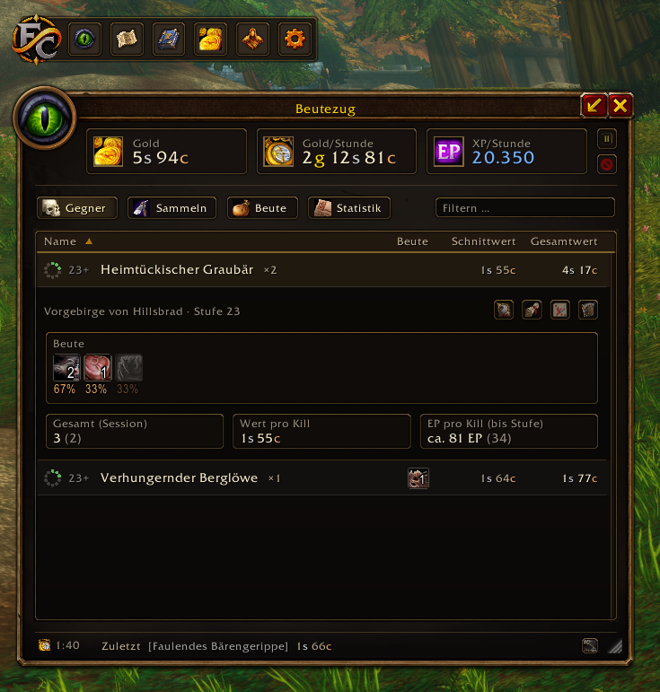
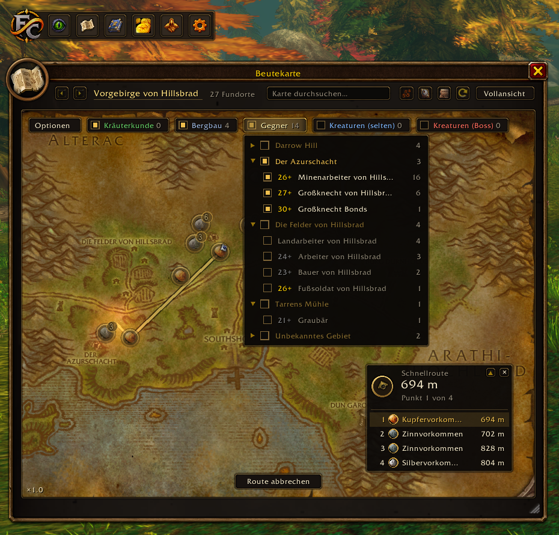
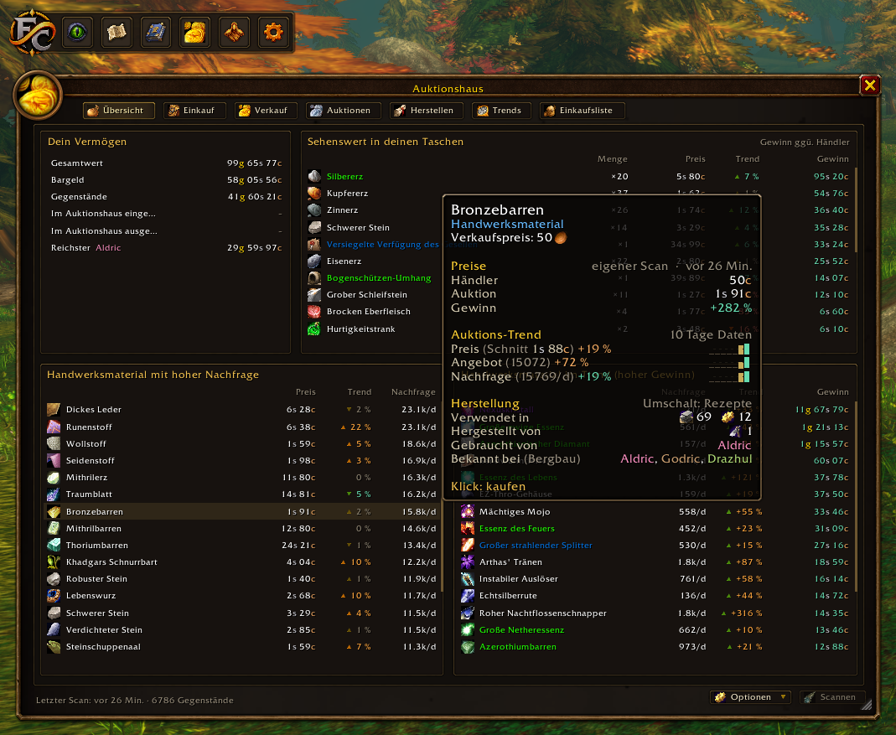
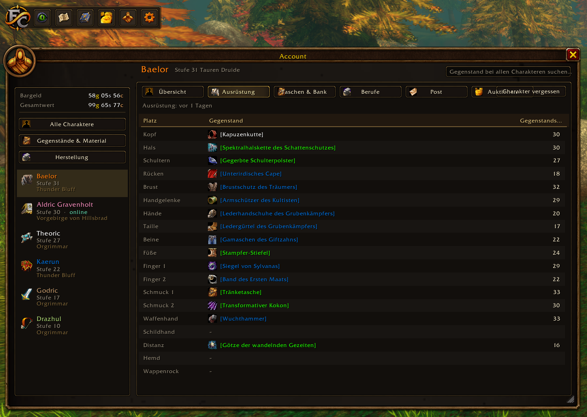

# Forever Companion

An all-in-one companion suite for **WoW Forever** (Classic-era client, Interface 16001). It logs what you
kill and loot, values it, shows it on a map, and keeps track of all your characters, in one gilded-brown
interface.

## Features

- **Loot log per source**: kills, drops and gathering (mining, herbalism, skinning, fishing) are recorded per
  creature or node, with drop chances that firm up as the sample grows.
- **Kills & Loot window**: live totals, value per hour, XP, best drops, goals and a footer with the session time.
- **Journal**: bestiary, gathering, item search, history and statistics.
- **Map window**: heatmaps and markers of where things drop, filters with hover menus, creature search with
  grouped markers, saved spots and routes.
- **Account window**: all characters with level, class, XP and rested bonus, location, professions and recipes,
  equipment, bags and bank, mail, auctions, worth and gold. Item and material search across characters, and a
  crafting view that shows what you can make and what you could still learn.
- **Auction house**: a Companion tab (and a window of its own, `/fcah`) with a dashboard, price lists and trends,
  recipes and crafting profit, a shopping list, your own auctions, and pages for buying and selling. Prices come
  from your own scans (or Auctionator), with 7-day price, supply and demand trends. Reference data of one realm
  is loaded at the first start so that there is something to look at before your first scan.
- **Tooltips**: items, creatures and gathering nodes get grouped, individually switchable lines (prices, trend,
  loot you got, where it drops, disenchanting, crafting, which characters own it, ...). The settings show a live
  preview.
- **Quick bar**: a small bar with one button per window; the minimap button shows and hides it.
- **Settings** with groups, cards, a reset per page and descriptions as tooltips; English and German.
- Everything is in the Blizzard window style.

## Screenshots

<table>
  <tr>
    <td align="center"> Kills &amp; Loot</td>
    <td align="center"> Loot map</td>
  </tr>
  <tr>
    <td align="center"> Auction house</td>
    <td align="center"> Account</td>
  </tr>
</table>

## Installation

1. Download a release ZIP (or clone this repository).
2. Make sure the folder is named exactly `ForeverCompanion` and sits in
   `World of Warcraft\<version>\Interface\AddOns\`.
3. Restart the game (a `/reload` is not enough for a new addon).

## Commands

| Command | Opens |
|---|---|
| `/fc`, `/companion` or `/codex` | Main command (`/fc journal`, `/fc reset`, `/fc minimap`, ...; the chat help lists them) |
| `/fcbar` | Quick bar (shown at the first start) |
| `/fcmap` | Map window |
| `/fcaccount` or `/fcalts` | Account window |
| `/fcah` | Auction house window |
| `/fcsettings` | Settings |
| `/fcmini` | Mini map |

Minimap button: click = quick bar, Shift + click = Kills & Loot, right-click = settings.

Windows are moved by their title bar. The corner grip of a window scales it.

## Notes

Nothing here is verified by automated tests: it is a game UI addon and is checked in the client. Please report
problems with the steps that led to them (and `/fc debug` output for loot or gathering issues).

## License

Copyright (c) 2026 Christian Remy. All rights reserved. See [LICENSE](LICENSE). The bundled libraries in
`Libs/` keep their own licenses ([notices](Libs/THIRD_PARTY_NOTICES.txt)).
